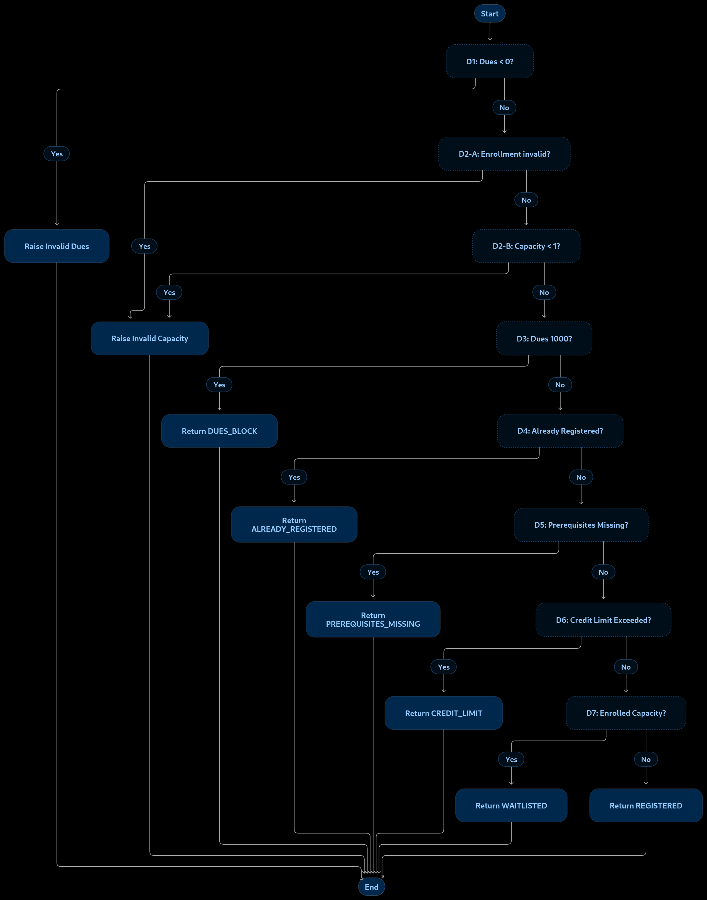

# Control Flow Graph (CFG) Analysis

## 1. Introduction

Control Flow Graph (CFG) is a graphical representation of the execution flow of a program. It shows the statements, decisions, branches, and possible execution paths.

For this assignment, the `registration_decision()` function of the Student Course Registration System is selected for white-box analysis.

## 2. Function Under Analysis

The function `registration_decision(student, course)` evaluates whether a student can register for a course.

It checks the following conditions:

- Negative outstanding dues.
- Invalid course capacity or enrollment.
- Outstanding dues blocking registration.
- Duplicate registration.
- Missing prerequisites.
- Credit limit.
- Course availability.

## 3. Control Flow Graph

The following image represents the control flow of the selected function.

The editable Mermaid source is available in `CFG_Diagram.mmd`.

## 4. Decision Point Analysis

The function contains seven `if` statements. The capacity validation condition also contains an OR operator.

| Decision | Condition | Purpose |
|---|---|---|
| D1 | `student.outstanding_dues < 0` | Checks for negative dues |
| D2 | `not 0 <= course.enrolled <= course.capacity or course.capacity < 1` | Validates enrollment and capacity |
| D3 | `student.outstanding_dues > 1000` | Checks the dues blocking condition |
| D4 | `course.code in student.registered_courses` | Checks duplicate registration |
| D5 | `not prerequisites_satisfied(...)` | Checks prerequisites |
| D6 | `not check_credit_limit(...)` | Checks the credit limit |
| D7 | `course.enrolled > course.capacity` | Checks the waitlist condition |

## 5. Cyclomatic Complexity

Cyclomatic complexity measures the number of linearly independent paths through a program.

The formula is:

**M = E - N + 2P**

Where:

- E = Number of edges.
- N = Number of nodes.
- P = Number of connected components.

Using the decision-point method:

**M = Number of decision points + 1**

There are seven `if` statements and one additional Boolean OR operator.

**M = 7 + 1 + 1**

**Cyclomatic Complexity = 9**

Therefore, nine linearly independent basis paths are identified in the structural analysis.

## 6. Basis Path Analysis

| Path | Condition | Expected outcome |
|---|---|---|
| P1 | Outstanding dues are negative | ValueError: Invalid dues |
| P2 | Enrollment is greater than capacity | ValueError: Invalid capacity or enrollment |
| P3 | Capacity is less than 1 | ValueError: Invalid capacity or enrollment |
| P4 | Outstanding dues are greater than 1000 | DUES_BLOCK |
| P5 | Student is already registered | ALREADY_REGISTERED |
| P6 | Prerequisites are missing | PREREQUISITES_MISSING |
| P7 | Adding the course exceeds the credit limit | CREDIT_LIMIT |
| P8 | Course is full and the student is otherwise eligible | WAITLISTED |
| P9 | All registration conditions are satisfied and a seat is available | REGISTERED |

## 7. Unreachable Path Analysis

The source code contains the following condition:

`if course.enrolled > course.capacity:`

This condition is intended to return `WAITLISTED`.

However, an earlier validation condition raises a `ValueError` whenever enrollment is greater than capacity.

As a result, this WAITLISTED branch cannot be reached through normal valid inputs in the original implementation.

The requirement states that a student should be waitlisted when the course is full, meaning:

`course.enrolled == course.capacity`

The implementation does not correctly handle this condition. This is an identified defect.

P8 is therefore a structurally identifiable but infeasible path in the original implementation. It must not be reported as successfully executed.

## 8. Conclusion

The CFG analysis identifies seven `if` statements and one additional Boolean OR condition, resulting in a cyclomatic complexity of 9.

The analysis identifies nine structural basis paths and highlights an unreachable WAITLISTED branch.

These findings support the design of white-box test cases and the identification of defects in the original registration system.
